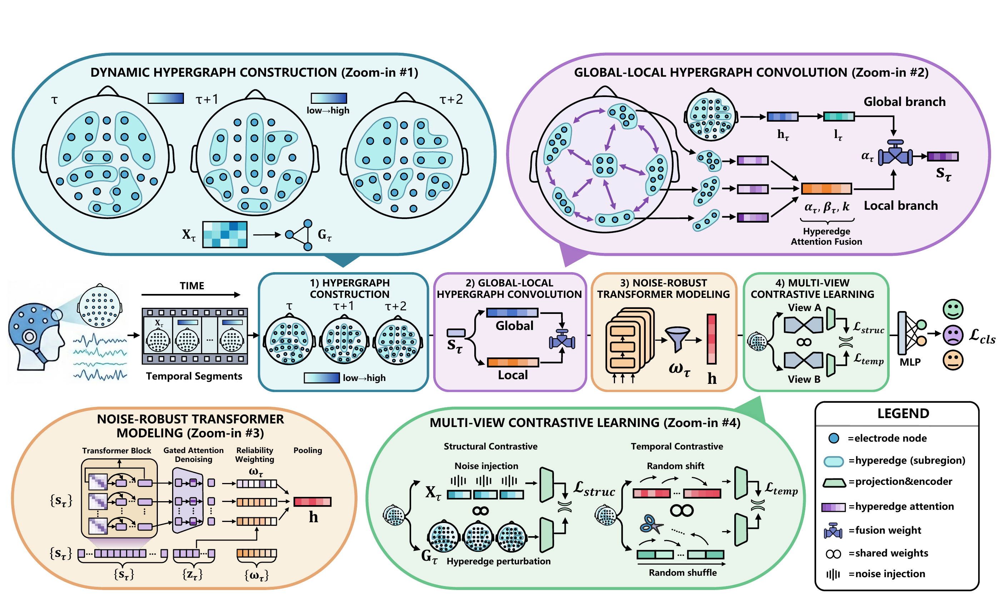

# MTHGNN

**Multiscale Temporal Hypergraph Neural Network for Cross-Subject EEG Emotion Recognition**

MTHGNN models emotion-related EEG activity through dynamic hypergraphs, global-local hypergraph convolution, reliability-guided temporal aggregation, and structural and temporal contrastive learning. The paper has been accepted by *IEEE Transactions on Affective Computing*.



## Architecture

1. **Dynamic hypergraph construction:** learn sample-adaptive electrode-to-hyperedge assignments at each time step.
2. **Global-local hypergraph convolution:** combine whole-brain higher-order interactions with hyperedge-level local representations.
3. **Noise-robust temporal modeling:** use a Transformer and reliability-guided attention to aggregate the EEG sequence.
4. **Multi-view contrastive learning:** expose structural and temporal view embeddings for the two contrastive objectives alongside supervised classification.

## Model file

`Model.py` contains the complete model architecture. The published class `MTHGNN` is an alias of the original `TimeAvgDHGNN` class. The full global-local branch and Transformer are always active; ablation switches have been removed.

The model expects an already segmented differential-entropy tensor with shape `[batch, time_steps, 62, 5]`. Its `forward` method returns class logits with shape `[batch, num_classes]`.

```python
import torch
from Model import MTHGNN

model = MTHGNN(
    in_channels=5,
    num_electrodes=62,
    num_layers=2,
    hid_channels=32,
    num_hyperedges=10,
    num_classes=3,  # SEED: 3; SEED-IV: 4; SEED-V: 5
)

segments = torch.randn(2, 10, 62, 5)
logits = model(segments)
print(logits.shape)  # torch.Size([2, 3])
```

The full model uses an entropy-scaling coefficient of 5, a reliability mixing coefficient of 0.5, and a stabilizing term of `1e-4`. `encode_views` and `encode_temporal_views` provide the embeddings used by structural and temporal contrastive learning, respectively.

## Reported results

The accepted manuscript reports the following cross-subject LOSO results (mean ± standard deviation):

| Dataset | Accuracy | Macro-F1 |
| --- | ---: | ---: |
| SEED | 0.8610 ± 0.0504 | 0.8566 ± 0.0517 |
| SEED-IV | 0.6980 ± 0.0810 | 0.6941 ± 0.0832 |
| SEED-V | 0.7262 ± 0.0814 | 0.6907 ± 0.1014 |

This repository publishes the core model file and its architecture figure. The dataset preprocessing, training pipeline, and baseline implementations are not included.
